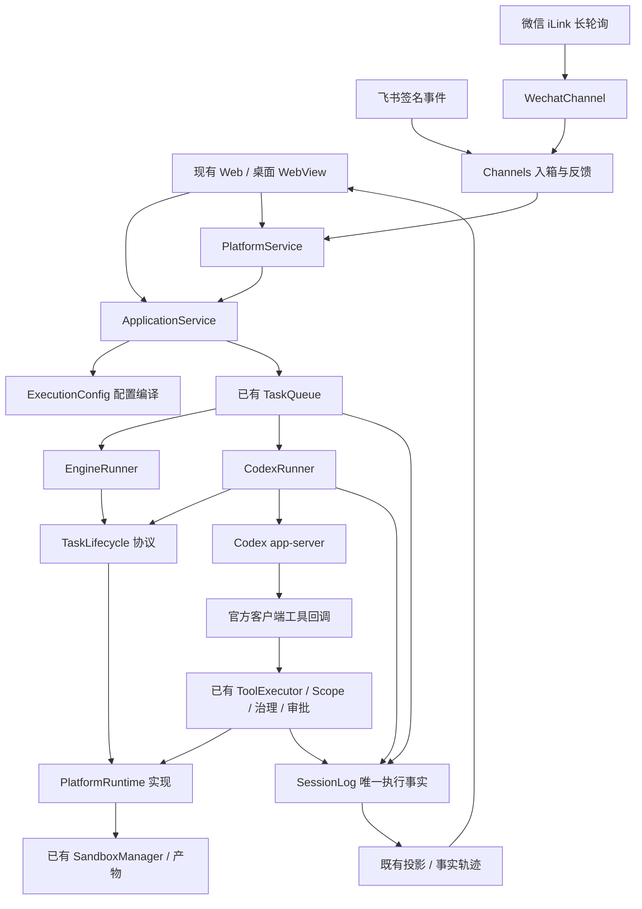

# 五项实施后的职责与依赖

## 责任边界

|边界|修改前|修改后|
|---|---|---|
|应用服务构建执行器 C1|ApplicationService 直接解释平台 Agent、模型连接、预算、MCP 和权限配置|`execution_config.compile_execution` 负责配置编译；服务负责会话资源与执行器选择|
|引擎任务适配 C2|engine 导入平台账号身份，直接处理证据、时限、完成和释放|core `TaskLifecycle` 协议；PlatformRuntime 实现平台生命周期；engine 只调用协议|
|Codex|无外部执行器|application `CodexRunner` 实现已有 TaskRunner；integrations 只负责官方 stdio 传输与版本/继承能力控制|
|文件/命令治理|ToolExecutor 与 PlatformRuntime 已有唯一执行链|Codex 客户端工具回到同一链；没有旁路运行工具或新任务编排器|
|外部入口|没有飞书/个人微信入口|Channels 负责入箱、渠道映射、反馈投递状态；任务仍只在已有 TaskQueue 执行|
|个人微信|没有个人账号协议|WechatChannel 负责账号/游标/连接生命周期；ILinkClient 负责 HTTP 协议|
|轨迹|已有事实投影与 JSON 详情，但外部事实/输入/结果呈现不足|补充事实词表、任务归属与单会话查询；独立前端轨迹组件读取同一日志和 API|

入箱数据库只存渠道接收、会话映射、投递与重试，不存第二套执行状态机。运行终态、审批、工具、产物真源仍是 SessionLog。微信游标只有在本批消息持久入箱后推进；结果发送的状态不能代替任务执行状态。

## 类型改善与规模

按相同源码口径，service.py 1507 → 1506 行，engine.py 1521 → 1522 行。此次没有用“搬行数”作为重构成功标准：抽出配置/生命周期同时加入明确协议和资源边界，公共入口兼容。两文件 `Any` 字符出现数分别 37 → 33、109 → 84；这是词法统计，不冒充全项目静态类型检查结果。

EngineSpine 的会话、事件总线、注册表、Scope、LLM、ToolExecutor、审批、计数器、提示词、压缩、目标、待办、技能、队列、调度、Job/Subagent 等关键字段改为具体类型。EngineRunner 的执行/取消函数采用 Task 与 RunnerResult 契约；TaskLifecycle 采用 Envelope 与 ExecutionContext。仍保留装配壳、插件兼容面、治理组合对象等真实动态边界的 Any，没有构造一个庞大 shared 模块掩盖差异。

## 依赖与循环

`scripts/analyze_dependencies.py` 使用 AST 比较基线 `7b1bdeab` 与当前源码。模块 129 → 139。立即模块导入图在两者均无循环。engine → application 的反向依赖从 `application.accounts` 一项降到零；平台身份由生命周期适配器管理。

包含函数内延迟导入和 TYPE_CHECKING 的全图仍有若干强连通组：总线/插件/工具 Guard、LLM/租户设置、桌面 app/bridge/launcher/net、持久化/修复。这些是已有兼容或装配依赖，不是新的立即导入环。本次应用服务/配置编译/渠道/微信组是惰性工厂与类型引用形成的双向边界，运行时依然单向装配、无立即循环。报告不将延迟或仅类型引用误称为运行时循环已消除。

会话日志与列表/事件投影缓存、插件、子任务、进程所有权已在现有专门模块中。核对后保留这些正常依赖，避免重复实现；本次仅针对实际发现的取消启动窗口补了 Provider Task 的明确所有权。服务关闭先停止渠道收发，再关闭引擎、队列、连接、会话和 LLM 资源，保持原有失败收敛。

该 AST 检查不分析字符串动态加载或 Python 运行时猴子补丁；运行时验证由功能/生命周期测试和全量回归补充。完整边清单、循环组和前后数字保存在本次证据目录 `dependencies.json`。
