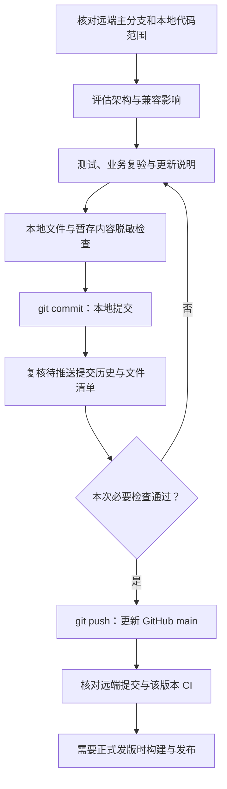

# GitHub 上传与更新记录

本文只约定代码核验、提交与上传。更完整的软件工程流程和个人偏好分类另行讨论，不在本次扩展。

## 本项目的提交方式

按本次维护者选择，合格改动直接推送 `main`，不要求创建公开工作分支或拉取请求。开发可使用本地独立 worktree，避免混入其他目录未完成的改动；worktree 只隔离文件与分支，不是阻断网络的安全沙箱。

本地 `git commit` 保存选定修改的版本记录；`git push` 上传提交到 GitHub。两者分开，上传必须在检查通过之后。远端发生新提交时重新核对差异与验证，不强制覆盖别人的更新。

## 逐步检查与交付

| 步骤 | 工作内容 | 交付物 | 放行标准 |
| --- | --- | --- | --- |
| 范围 | 比较在线主分支、各 worktree 和未提交改动 | 明确文件清单与基线 | 不把旧目录整体覆盖主分支，不重复合并已包含的历史 |
| 影响 | 检查运行路径、权限、事件、数据兼容与新依赖 | 架构影响说明 | 核心行为变化有相应回归；不宣称零影响 |
| 核验 | 运行本次必要测试与实际业务场景 | 通过/失败/缺环境及证据 | 新发现失败先定位；历史成绩与本次结果分列 |
| 更新 | 使用更新模板说明前后行为、如何复现、风险和回退 | `docs/updates/` 条目及索引 | 写的是实际改动与实际结果，不是将来的计划 |
| 脱敏 | 检查代码、暂存内容、提交历史及准备上传的证据/安装包 | 仅包含脱敏摘要的检查结果 | 没有未处理的真实凭据或私人业务资料；可疑项逐条判定 |
| 提交 | 只选择本次文件，生成本地 Git commit | 可追溯的提交 | 不使用无选择的全目录暂存混入日志、会话和本机材料 |
| 上传 | 快进推送主分支并核对远端和 CI | 主分支提交链接 | 不以旧提交的绿色 CI 代替新提交结果；失败如实报告 |
| 发版 | 有正式版本需求时，生成版本说明、包、校验值和安装记录 | Release 与构建对应关系 | 测试源码、构建和安装版本一致；不把上传代码当正式发版 |

## 脱敏边界

允许上传的通常是本次源码、必要测试、公开说明和有意设计的合成夹具。私人会话、运行数据目录、凭据文件、原始供应商请求、含敏感信息的截图与日志不随代码上传。

对公开副本使用合成数据与通用路径。原始审计证据保留在本地，不篡改后冒充原截图。扫描器不覆盖所有个人信息或图片内容，仍需检查拟公开的证据。若发现真实凭据已泄露，先撤销/轮换，再评估历史清理；不能仅在当前文件里打码。

GitHub 推送保护是补充检查，不能代替上传前检查。单独依赖 `.gitignore` 也不能清理已经被跟踪或进入历史的文件。

## 已有 CI 与结果口径

仓库配置包含跨平台测试、权限/隔离检查、真实 Docker 场景、Web 冒烟、包验证和安全检查。以目标提交实际运行结果为准：跳过不冒充实测通过；固定模型流程验证不冒充在线模型质量；缺环境的独立业务签署不冒充完成。

是否配置依赖自动更新、其他仓库规则或正式发布证明，应结合当前维护方式单独确认。采用直接更新主分支时，不擅自增加“必须经拉取请求”规则。

## 上传后维护者怎么查看

1. 从项目README的“本次修改与核验结果”进入更新索引，查看最新批次的业务变化与核验结论。
2. 先读“仍未关闭的事项”和“需要维护者提供的条件”。代码修复、测试失败、脱敏与上传由执行者处理，不默认转交维护者排查。
3. 在GitHub Actions核对本次提交的检查。旧提交通过不能替代当前提交；自动化通过也不等于独立业务验收完成。
4. 需要实际使用时，按同一版本的安装/启动说明验证，不把旧运行程序作为新提交的验收对象。
5. 只有真实独立审阅人、明确业务目标及写回范围等外部条件，才列为维护者待办。没有这些条件时保持缺环境，不伪造通过。

CI用于自动构建、测试与检查；CD指配置好的交付或部署流程。仓库的包构建和文档网站发布不等于业务程序自动部署。正式发布另核对版本说明、安装包和数据兼容。

## 官方资料

- [GitHub 自动版本说明](https://docs.github.com/en/repositories/releasing-projects-on-github/automatically-generated-release-notes)：可汇总合并记录，仍需补充业务变化与核验结果。
- [状态检查](https://docs.github.com/en/pull-requests/reference/status-checks)：检查结果应对应目标提交。
- [敏感数据处理](https://docs.github.com/en/authentication/keeping-your-account-and-data-secure/removing-sensitive-data-from-a-repository)：凭据撤销/轮换与历史清理是不同动作。
- [产物来源证明](https://docs.github.com/en/actions/concepts/security/artifact-attestations)：正式发布时可用于关联构建与源码；本项目是否启用另行决定。
