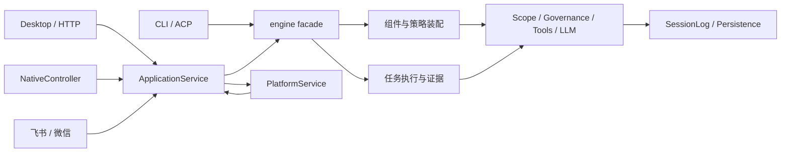

# PyHarness 生产实现解耦验收（2026-10-14）

本轮已实际迁移全部 27 个超长生产模块。迁移前 139 个生产 Python 文件，迁移后 239 个；全量扫描最大 598 行，超过 600 行的文件为 0。完整实现按职责迁移，没有删除场景、接口、配置、权限/治理、事件或数据能力。

## 最终验收

| 检查 | 实际结果 |
| --- | --- |
| 全量既有测试 | **2,811 通过，41 跳过，0 失败，0 错误**，共 2,852 项，336.976 秒 |
| 生产文件物理行数 | 239 个文件全部 ≤600，最大 598 |
| 受保护文件 | `tests/`、`scripts/` 共 242 个文件，SHA256 变化、删除和新增均为 0 |
| 原模块加载 | 拆分前 139 个模块均可按原路径导入，无缺失 |
| 当前全部模块加载 | 239 个模块全部导入成功 |
| 公共及兼容符号 | 2,510 个原函数、类与方法签名全部相同，无缺失；类的历史导入与 pickle 标识保留 |
| 配置与事件等模型 | 152 个 Pydantic 模型的完整 JSON Schema 与拆分前相同 |
| 源码定义保留 | 开始时 2,680 个类/函数/异步函数定义，当前 2,730 个；原定义名缺失 0，此项仅作删名防线，不替代行为测试 |
| HTTP 契约 | 完整 OpenAPI JSON 与拆分前相同，包含 116 条路径；原 `/api` 与 `/api/v1` 均保留 |
| 名称检查 | Ruff `F821,F822` 通过；开始时已有 4 项诊断也已修复 |
| 启动时导入循环 | 基线 0，当前 0 |
| 运行时依赖回边 | 区分延迟与类型导入后，归回原职责边界的 4 组与基线完全相同，没有新增 |
| CLI/Web | 已运行真实 console CLI 与 Web 帮助入口；命令集合和入口函数保留 |
| 桌面/原生 | 入口加载通过；原生窗口构建、9 个页签和信号的既有测试通过 |
| 安装包 | wheel 与源码包构建通过；wheel 内 239 个 Python 文件与源码集合相同，四个命令入口和原 UI 资源均可加载 |

41 个跳过均来自既有环境条件：固定版本的本地可选依赖 16 项、Windows 无 POSIX 权限语义或符号链接条件 25 项。另有 5 条既有依赖/示例弃用警告。没有把跳过算作已验证的平台能力。

最后一轮全量回归暴露的五项兼容问题已逐项修复，并先以 `five-fixes.xml` 的 5/5 通过记录确认，再重跑最终全量测试：

| 回归点 | 最终实现 |
| --- | --- |
| Web 治理审计读面 | `DesktopApp` 保留实际调用 `ApplicationService.governance_audit/governance_evidence` 的公开方法 |
| 工作区派生单点 | `engine.py`、`core/subagent.py` 继续实际调用既有 `session_workspace`；组件只接收已声明的派生回调 |
| CLI/ACP 装配入口 | 旧 facade 保留实际 `attach_engine_to_ctx` 调用；命令协作模块通过注入调用，无反向导入 |
| 工具治理汇点 | `ctx.governance.authorize` 继续只有 `tools_executor.py` 一个实际调用点，审批重入也委托该汇点 |
| 同步 Provider 线程池 | 创建仍经执行器原兼容面，调用模块负责完成、失败和取消时的释放；既有关闭观察测试通过 |

## 实际职责边界

* `desktop/app.py` 保留认证装配、会话执行兼容面和明确的治理读面；`authority`、`pages`、`routes`、`handlers`、`lifecycle` 承担相应职责。操作者令牌物理写入仍在原审计入口。`platform_api.py` 保留路由策略与挂载，渠道、任务、助手、产物、管理按功能成组注册。
* `ApplicationService` 保留实例状态、会话及运行装配；租户配置、编排、历史审计、人工交互、技能插件分别由职责协作类实现。协作类使用原服务实例，不另建状态或存储。
* `PlatformService` 保留平台组合及生命周期，助手版本、任务、历史、产物、知识/连接分组。产物字节写入仍由原平台服务唯一承担。
* CLI 保留入口、交互、明确的引擎装配及日志订阅；解析、渲染、会话维护、历史查询和编排分别迁移。引擎保留生命周期协调、模型注册与工作区派生，拆出类型、策略、组件、插件、任务执行与事件投影。
* LLM 保留 `LLMClient._chat_any` 唯一动态出网点、公开出口和具体适配器定义；协议类型、流聚合、用量、HTTP 传输、请求生命周期分开。工具执行器保留唯一治理授权与 Provider 获取点，以及线程池创建兼容面；调用、审批重入和结果模型分开。
* 持久化保留单写者、锁、实际文件写入和会话/辅助文件判据；读取、缓冲写入协调、恢复投影分开。修复入口保留物理修改与时间源，扫描、派生视图恢复分开。
* 配置的原 `Settings` 与声明语义保留，配置值处理和独立字段模型分开；事件载荷按会话、执行、编排、治理分组。作用域、计划、调度、子任务、全文索引和原生窗口也按真实职责迁移。

没有新增巨型 shared/common 模块。下层协作模块不通过导入组合 facade 来取状态；需要保留旧兼容配置点时，由 facade 显式注入回调，如模型注册、工作区派生、日志订阅和时间源。



此图表示调用协作关系，不把运行时对象回调误称为模块导入。完整模块导入图保存在验收目录的 `dependencies.dot`。

## 超长文件迁移结果

| 原文件 | 开始时行数 | 最终行数 |
| --- | ---: | ---: |
| `pyharness/acp.py` | 744 | 458 |
| `pyharness/application/platform_service.py` | 1068 | 151 |
| `pyharness/application/service.py` | 1506 | 446 |
| `pyharness/cli.py` | 1833 | 585 |
| `pyharness/config.py` | 864 | 521 |
| `pyharness/core/approval.py` | 1071 | 403 |
| `pyharness/core/compaction.py` | 676 | 506 |
| `pyharness/core/llm.py` | 1426 | 446 |
| `pyharness/core/plan_mode.py` | 638 | 549 |
| `pyharness/core/schedule.py` | 839 | 425 |
| `pyharness/core/scope.py` | 655 | 553 |
| `pyharness/core/session.py` | 604 | 592 |
| `pyharness/core/session_query.py` | 1051 | 307 |
| `pyharness/core/spill.py` | 652 | 376 |
| `pyharness/core/subagent.py` | 1128 | 240 |
| `pyharness/core/task_queue.py` | 647 | 598 |
| `pyharness/core/tenant_settings.py` | 756 | 580 |
| `pyharness/core/tool_web.py` | 791 | 552 |
| `pyharness/core/tools_executor.py` | 876 | 564 |
| `pyharness/core/tools_guard.py` | 1142 | 591 |
| `pyharness/core/tools_registry.py` | 655 | 391 |
| `pyharness/desktop/app.py` | 1399 | 411 |
| `pyharness/desktop_native/main_window.py` | 924 | 216 |
| `pyharness/engine.py` | 1522 | 416 |
| `pyharness/events/payload.py` | 756 | 64 |
| `pyharness/persistence.py` | 1157 | 586 |
| `pyharness/repair.py` | 996 | 375 |

原 `desktop/platform_api.py` 虽只有 460 行，也按功能拆为 64 行的兼容挂载入口。

## 依赖审计的边界

不能把“启动时循环为 0”解释成所有延迟依赖都不存在。开始时已有四组延迟回边，当前仍保留：

1. `bus / bus.plugin / tools_guard`：插件守卫注册的延迟依赖。
2. `core.llm / core.tenant_settings`：租户凭据解析与模型配置验证。
3. `desktop.app / desktop.launcher`：关闭生命周期；迁移后相应方法位于 `desktop.lifecycle`。
4. `persistence / repair`：历史修复兼容入口；迁移后扫描与恢复子模块参与这组关系。

它们不在模块初始化时执行回边，全部模块导入已实测通过；折叠回原职责边界后与开始时相同。`TYPE_CHECKING` 下的服务、渠道、调度、子任务和桥接器引用不在运行时执行，单独记录为类型边。原 `scripts/analyze_dependencies.py` 未修改；其把类型/延迟导入合并的结果仅作原始参考，最终以外部只读审计器逐边分类的结果为准。

## 可重复检查与证据

执行目录为本隔离工作树。最终回归命令：

```powershell
.venv/Scripts/python.exe -m pytest tests --no-cov -q --tb=short --junitxml="%USERPROFILE%/Documents/Codex/2026-10-14/pyharness-decoupling/final-regression.xml"
uvx ruff check pyharness --select F821,F822 --output-format concise
.venv/Scripts/python.exe "%USERPROFILE%/Documents/Codex/2026-10-14/pyharness-decoupling/audit_dependencies.py"
.venv/Scripts/python.exe "%USERPROFILE%/Documents/Codex/2026-10-14/pyharness-decoupling/audit_surface.py" . surface-after.json
```

最小物理行数复核，不依赖专用脚本：

```powershell
@'
from pathlib import Path
rows = [(len(p.read_text(encoding="utf-8").splitlines()), str(p)) for p in Path("pyharness").rglob("*.py")]
print("files:", len(rows), "max:", max(n for n, _ in rows))
print("over_limit:", [(n, p) for n, p in rows if n > 600])
'@ | .venv/Scripts/python.exe -
```

验收目录：`%USERPROFILE%/Documents/Codex/2026-10-14/pyharness-decoupling`。

* `final-regression.log/.xml`：最终全量回归；`five-fixes.xml`：最后五项兼容回归均通过。
* `production-before.json`、`before.patch`：本轮开始时生产源码和既有差异；`production-after.zip`：最终生产代码及本轮文档快照。
* `protected-before.json`、`protected-after.json`：242 个测试/脚本文件指纹。
* `surface-before.json`、`surface-after.json`、`import-audit.json`：导入、2,510 个签名、HTTP 契约。
* `definition-audit.json`：原定义名保留和 152 个模型 Schema 精确对比。
* `dependency-audit.json`、`dependencies.dot`：完整行数、导入位置、类型/延迟分类及基线对比。
* `ruff-before.log`、`ruff-final.log`：开始时四项诊断与最终零诊断。涉及原有的 Codex 输出摘要导入次序、进程清理异常对象捕获、模型替换错误分支导入，均保持原预期行为。
* `dist/`、`package-audit.json`：构建产物、包内文件与入口加载。
* `delivery-manifest.json`：最终文件与证据 SHA256。

本轮没有提交、推送、发布，也没有修改 Git 身份、账号凭据或渠道数据。此前已暂存的实现保持原索引；本轮改动保留在工作目录，新增职责模块仍是未跟踪文件，接回时须一起纳入，不能只取 `git diff` 中的已有文件。已运行的绑定实例没有被重启；正常重启后才会加载本轮代码。
