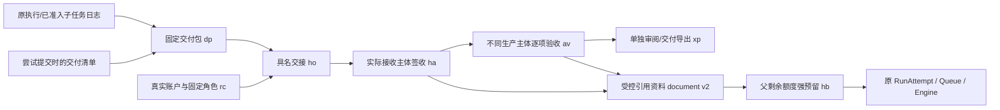

# 产品交付与具名承接契约

对应ADR-029、C02/C04/A02。S10当前实现及验收证据见`.ai-coding/TASK-s10-20261019.md`；阶段完成状态以持续进度账本为准。

|资源|ID/修订|写入与验收条件|当前读取条件|
|---|---|---|---|
|delivery_package|dp + 16hex；不可变1|精确execution/delivery引用；30项目、60映射、40唯一输出；所有必交项目有实际输出|当前固定清单/任务、来源授权、产物物理字节与承接依赖|
|role_contract|rc + 16hex；CAS 1–200|实际生产主体；真实同租户owner/member接收者；reviewer无Agent，consumer固定发布版本且能力不超父|所有当前交接锁定确切角色修订；退休及修订使旧授权不可继续使用|
|role_handoff|ho + 16hex；不可变1|角色和包同生产者/父执行；明确输出子集、最小上下文，总文本受角色上限约束|真实创建者或接收者；当前成员资格/角色/来源；不得因此读取生产者其他私有任务|
|handoff_ack|ha + 16hex；不可变1|仅真实接收者签收已授予的交接|读取不创建签收；签收不创建验收|
|delivery_acceptance|av + 16hex；不可变1|已签收的reviewer；真实UID不同生产者；必交标准逐项覆盖；拒绝重复/未知标准索引|固定包、标准与输出仍有效；新包/新结论/撤权均重新核对；unknown非pass|
|delivery_export|xp + 16hex；不可变1|原生产者另行授予确切接收者和对象；delivery用途必须绑定当前通过的独立验收|仅指定接收者下载；前后重核摘要、主体、来源、角色和验收|
|handoff_budget|hb + 16hex；不可变1|服务端派生，非公共创建命令；精确attempt/execution/role/package/handoffs；完整子额度先强确认|不自动退还或借新键重用；当前原边界持续核验|
|document schema2|原doc ID；不可变1|已签收受控输出；consumer还需有效独立验收；UTF-8整段/固定区间或已确认PDF预览|每次读/引用/执行重核原授权与原字节；旧Doc1入口不能把该ID改回普通资料|

原事件类型和SYNC集合不新增；继续使用`workspace.resource_committed`的严格资源分派、原私有blob、原锁及强确认。单类资源每项目历史总计上限200，角色修订同样计入；控制blob有界。文件输出上限32MiB，导入PDF沿用2MiB/200物理页限制，引用文本与最小说明合计不超过角色声明且最大98304字节。公开最终文本与生成文件均保留原sid/task/seq；子任务需原准入、调用者及生命周期证明。

## HTTP入口

所有新入口保留原租户/账户/CSRF与生命周期中间件，返回`Cache-Control: no-store`。普通成员可以操作自己的产物与明确授予自己的交接；viewer不能借新路径获得写权限。固定ID与原键均严格校验，重复/额外查询参数拒绝。

|入口（均在`/api/v1/projects/{project_id}`下）|方法|用途|
|---|---|---|
|`/delivery-center`|GET|实际主体可见的有界控制元数据与自己已绑定交付要求的生产执行；不自动读取所有输出|
|`/executions/{execution_id}/delivery-outputs`|GET|实际原日志输出清单与有界公开文本节选；不授予下载|
|`/delivery-packages`，`/delivery-packages/{id}`|POST / GET|冻结实际产物与读取当前精确绑定|
|`/role-contracts`、`/role-handoffs`、`/handoff-acks`、`/delivery-acceptances`、`/delivery-exports`|POST|分开保存事实；每个入口另有`GET /{id}`当前读取|
|`/delivery-exports/{id}/outputs/{index}`|GET|指定接收者读取指定原始字节，附件/no-store/nosniff|
|`/handoff-document-previews`|POST|非持久PDF预览，给出绑定主体/对象/解析版本的确认摘要|
|`/handoff-documents`|POST|显式schema2导入；不变更旧`/documents`命令schema|
|`/delivery-submissions/by-key?key=…`|GET|只返回原键、资源ID、版本、摘要、seq与writer状态；来源已不可读时仍可核对自己的提交是否持久|

除预览外所有POST需`Idempotency-Key`，未知回执只能读原键或按相同键/完整选择重试。blob写入后、事实追加前与回执读回时重核当前权限；无法证明强提交则保持unknown/503，不把内存缓存当持久事实。文本区间按Unicode codepoint并固定quote_digest；PDF按真实物理页，空白页不改编号，不执行OCR或主动内容。
