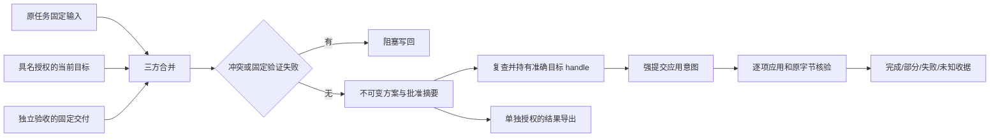

# 三方合并与安全写回

> 当前状态更新（2026-10-21）：本规格对应能力已在S08–S18相应阶段及S18统一版本中验收。下文旧阶段状态为实现历史，当前边界与交付核验见[统一版本说明](../user-guide/unified-delivery.md)。S19最终交付须以新源码冻结和新CI为准。

S11/C03；当前实现待整体验收。读接口、预览、冻结方案、批准应用和下载授权是五个不同动作。此前版本没有此宿主文件写回能力；既有输入、工具执行、交接和审批入口保留。

|步骤|工作|交付|验收标准|状态/依赖|
|---|---|---|---|---|
|11.1|固定输入/目标/交付版本|三方差异与冲突信息|预览零写；用户编辑不丢失；BOM/CRLF 保留|已实施，待当前源总验收|
|11.2|真实 owner 的独立写范围、内置验证与方案|writeback_grant、merge_plan|不借 read grant 写；固定完整摘要与接收人|依赖 S10 独立验收|
|11.3|强意图、独占目标、实际结果|writeback_application revision 1/2|目标变化拒绝；部分不冒充完成；原方案不重放|已实施，待真实 HTTP/安装总验收|
|11.4|界面、导出、兼容和恢复包|工作台与同源证据|真实/脚本/条件单列；通过后进入 S12|待本阶段完整验收|

## 固定来源和权限

具名授权由当前真实团队 owner 签发给当前 owner/member；本地无账户模式使用 local-operator。读取、应用、导出均使用实际请求者；不冒充交付生产者，也不靠 Agent 名改变身份。

授权固定 root identity、精确相对路径、明确操作和 UTC 到期时间，支持单向撤回。拒绝 UNC、路径逃逸、ADS、保留/敏感名字、链接/junction/hardlink、私有用户数据/control/blob 根及其重叠祖先。目标父目录必须存在；不隐式建目录或扫描整个磁盘。签发授权仅写控制事实，不写目标文件。

方案绑定当前固定交付包和逐条独立通过的验收记录。来源撤回、验收人移出、更新验收/交付、目标授权撤回/过期、根身份或项目版本变化，都不能沿旧批准继续写。原输入基线从确切 WorkspaceInput 读取，不重新抓取目标文件冒充基线。

每个目标显式选择 input_path 与实际 output_ref，或选择原执行中可核对的最终删除事件。创建使用不存在的基线；删除须有同一路径的实际 effect 收据。当前删除列表支持原 root 执行；不能用未登记的子会话或文字说明替代删除证明。

## 合并与固定验证

UTF-8 原字节、BOM、行尾保持。当前=交付时无需写；当前=基线时采用交付；交付=基线时保留当前用户修改。其余采用保守行差异合并，重叠编辑或歧义阻塞。并发文本比较限每版 1 MiB、4096 行；超过限制仍可显示明确的阻塞，不猜测结果。

每次最多 100 个目标，选定交付正文合计至多 10 MiB，四份版本总处理量至多 40 MiB，预览和存储记录至多 512 KiB，单文件至多 10 MiB。总操作沿用 30 秒控制捕获边界。差异展示有界，截断不改变完整字节摘要。

内置验证版本 `text-policy-syntax-v1`：沿用拒绝秘密/控制字节的 UTF-8 内容策略；Python 用 AST 解析，JSON 用解析器验证并拒绝非有限数。Python/JSON 在进入解析器前限制为 128 KiB，避免用 10 MiB 的文本上限分配巨大语法树。不会 import 或运行交付代码，不接受 shell 命令或客户端验证器。当前不应用二进制、PDF 或保留敏感配置；既有 PDF 资料导入不受影响。验证通过不代替独立业务验收。

目标 Snapshot 的 device/inode/mtime 采用精确十进制字符串，避免 NTFS 64 位编号在 JavaScript 中失真。保存方案后，不同目标版本不会悄悄重新合并覆盖旧批准。Web 会校验完整持久方案 blob、批准摘要和实际结果 blob 后才显示可批准/完成状态。

## 应用与异常

当前应用后端为 Windows：先持有根/父目录 handle，再独占所有已有目标并比对确切版本；无冲突后才强提交应用意图。新文件使用 CREATE_NEW，已有文件持有独占 handle 写入、flush/fsync 和读回，删除通过准确 handle 发出。正常释放后其他编辑器可以继续写。

文件组不构成 OS 全局事务。部分文件已变更时不自动还原或报全部成功；写入中异常后实际字节可能为 unknown。控制回执不确定时保留原始意图，冷启动只观察；同一 plan 换键或 ID 也不能重复应用。完成只代表最后一次持锁观察到各目标与合并摘要相同，不承诺后续人工编辑不能改变文件。

非 Windows 仍可预览、冻结和显式导出，在应用入口明确返回 backend unavailable，绝不降级普通 host 写入。浏览器会保留 realm/project/operation/ID/key/digest 的最少核对线索；不在 localStorage 保存路径正文、交付文本或用户秘密。GET 不自动签发授权或执行动作。

## HTTP 接口

均位于 `/api/v1/projects/{project_id}`，使用原认证、角色和 CSRF 边界，成功/失败响应均 no-store。

|方法/路径|语义|副作用|
|---|---|---|
|GET writeback-center|当前主体的授权/方案/申请/导出目录|无执行，无 writer|
|GET writeback-submissions/by-key?key=…|原键最少元数据核对，申请折叠至最新结果|不重放，无 writer|
|POST writeback-grants|owner 明确签发精确范围|唯一控制日志|
|POST writeback-grants/{id}/revoke|仅撤回|唯一控制日志|
|GET writeback-grants/{id}|授权元数据|无目标写入|
|GET delivery-packages/{id}/merge-source-options|自己的确切输入文件、选定输出和实际删除收据|只读原事实，无模型|
|POST merge-previews|当前三方比较|零目标及控制写入|
|POST merge-plans|复核预览摘要并保存不可变方案/私有原字节|控制日志和私有文件；零目标写入|
|GET merge-plans/{id}|固定方案与冻结差异|不替换为新目标|
|POST writeback-applications|显式批准摘要，意图确认后应用|仅精确授予的目标|
|GET writeback-applications/{id}|原申请的当前已记录结果|无目标读写或重放|
|POST merge-plan-exports|单独授权冻结结果下载|仅控制日志|
|GET merge-plan-exports/{id}|自己的导出授权|无目标写入|
|GET merge-plan-exports/{id}/files/{index}|复查后返回精确冻结字节|attachment/no-store/nosniff/CSP|

POST 保存/授权/应用须 Idempotency-Key；预览不消费提交键。资源分别为 wg/mp/wa/we 加 16 位十六进制 ID，每项目每类型最多 200 个历史修订。新类型复用 `workspace.resource_committed` 强同步事件，不新增主数据库、引擎或队列。
