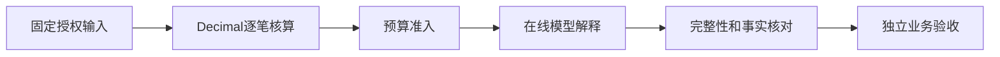

# 订单摘要与结果质量核对

执行结束、模型回答完整、程序计算核对、第二主体业务验收是四种不同状态。
Web执行详情和交付中心分别显示这些状态。来源一致只证明所选原文的字节一致。

| 情况 | 系统行为 | 用户下一步 |
|---|---|---|
| 预算不足 | 不发送该次模型请求；显示额度、预留、差额和限制来源 | 减少资料或明确修改专用任务额度，再新建尝试 |
| 模型以length停止 | 原文保留，结果不完整，执行失败；不自动续写 | 核对有效输出上限，修改配置后明确重试 |
| 模型结束原因未知 | 完整性待确认，不作为合格交付 | 核对供应商与执行日志 |
| 模型金额或问题清单冲突 | 保留原始llm.response，列差异；执行失败 | 核实差异后重新执行 |
| 确定性核对通过 | 可提交独立复核，不自动通过人工业务验收 | 使用现有角色移交和独立验收流程 |

预算输入预留使用包含工具定义的UTF-8字节保守估计，不是供应商实际token计量。
有效输出上限同时受到连接单次上限、任务/父级剩余额度和费用估算约束。
并发请求继续原子预留共享父级额度。费用估算不是供应商账单。

## 配置订单规则

在专用Agent草稿的`output_schema`中，保留正常JSON Schema并添加
`x-pyharness-order-review`扩展。保存和发布沿用原不可变Agent版本机制。
配置包含`schema_version:1`、固定输入中的`csv_path`与`rules_path`、
`cutoff`（YYYY-MM-DD）、`currency:"CNY"`及完整`columns`映射。
映射键为order_id/customer/product/quantity/unit_price/amount/payment_status/
received/shipping_status/promised_date。路径必须精确命中已捕获输入，不能授予新的文件访问。

规则仅在正式固定输入任务且使用engine执行器时可用，不与严格知识引用模式混用。
普通Agent不添加此扩展则沿用原行为。历史日志中缺少新字段时不补写或改变原产物摘要。

模型JSON必须包含summary、issues、normal_orders。程序给出核算事实和明确结构说明，
模型复制摘要，逐项返回order_id/code/action建议。金额用Decimal计算，不执行单元格公式。
错列、重复订单号、未知状态、非法金额、超过两位小数等中止核算，不当作零或静默舍入。
当前配置只支持单币种CNY、整数正数量以及明确的已付款/未付款、已发货/待发货状态。
不支持的业务口径需另外配置和验证，不能把本规则当作通用财务审计。

公开正文标注“程序核算”和“模型建议待人工复核”。原始模型回答保留在llm.response，
公开消息包含核算来源、规则、摘要和差异供追溯。模型建议的事实正确性仍需人工复核。
失败原文可以冻结为待复核材料；服务端对独立验收通过、合格导出和写回实施质量检查。
原始材料的审阅和证据下载不等于合格交付。
