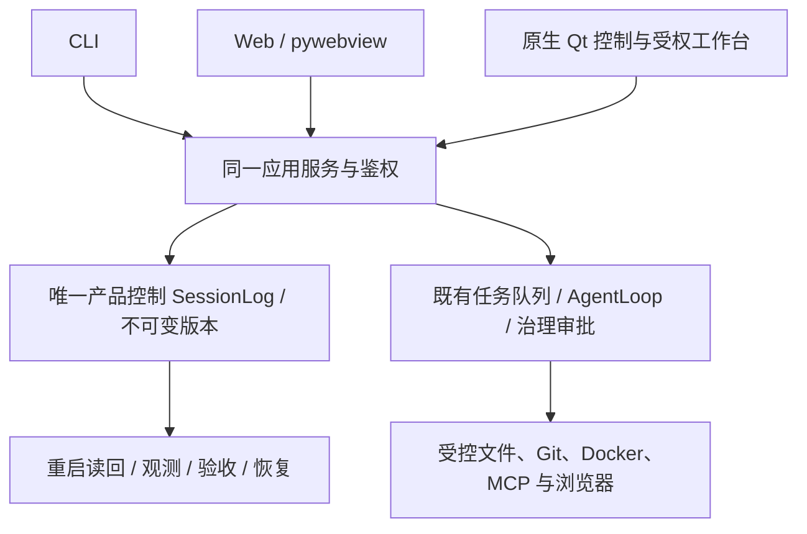

# 统一版本：运行、验证与恢复

本版整合既有 CLI、Web、pywebview 桌面与原生 Qt 入口，保留既有业务功能。S08–S18已逐阶段验收；S19最终交付需核对当前源码、安装包与本提交对应的 CI，不能以历史绿灯代替。

## 能力与边界

| 步骤 | 工作内容与交付物 | 验收标准 | 当前状态或依赖 |
|---|---|---|---|
| 08 | 检查点、纠错与安全恢复 | 新尝试续做，不自动重放未知外部效果 | 已验收；ADR-027 |
| 09 | 版本化任务 DAG 与准入 | 依赖、来源版本和权限逐次核验 | 已验收；ADR-028 |
| 10 | 交接与独立验收 | 实际不同主体、确切版本与可追溯结果 | 已验收；ADR-029 |
| 11 | 三方合并及显式写回 | 固定 base/ours/theirs，冲突不覆盖 | 已验收；ADR-030 |
| 12 | 上下文与运行观测 | 精确事实、授权隔离、重启可读 | 已验收；ADR-031 |
| 13 | 失败用例与数据集 | 人工确认、不可变修订、保密复核 | 已验收；ADR-032 |
| 14 | 固定预算实验 | 预算绑定、独立运行、可比较证据 | 已验收；ADR-033 |
| 15 | MCP/技能扩展工作台 | 真实受控进程、撤权与资源回收 | 已验收；ADR-034 |
| 16 | 配置验证和回滚 | 精确版本、失败关闭、重启恢复 | 已验收；ADR-035 |
| 17 | 受控浏览器 | 当次精确目标、真实读回、无动作重放 | 已验收；ADR-036 |
| 18 | 双壳与完整集成 | 共用服务与账户边界；原生关闭无残留 | 已验收；ADR-037 |
| 19 | 可重建源码、安装包和远端 CI | 本次完整测试、包检查、新提交 CI、私有恢复副本 | 依交付证据核验；ADR-038 |



## 安装和启动

使用 Python 3.11 或以上。开发环境使用锁定依赖，避免混用本机其他项目环境：

```powershell
uv sync --frozen --extra dev
uv run --frozen --extra dev pyharness-web
uv run --frozen --extra dev pyharness-native
uv run --frozen --extra dev pyharness-desktop
uv run --frozen --extra dev pyharness --help
```

安装 wheel 时，按需要选择 `web`、`desktop`、`native`、`pty` extras。`pyharness-native` 是注册入口；该包没有 `python -m pyharness.desktop_native` 入口。原生菜单可显式打开共用服务的完整工作台；已有账户或其他租户须登录，不从租户选择器取得认证。

浏览器测试使用 `dev` 中固定的 Python Playwright 及其自带 Node/JS 驱动，使用宿主已安装 Chrome/Edge，不自动下载浏览器。可显式设置 `PYHARNESS_TEST_BROWSER_NODE`、`PYHARNESS_TEST_PLAYWRIGHT_INDEX`、`PYHARNESS_TEST_BROWSER_EXECUTABLE` 为可信绝对文件路径。缺依赖会失败，不增加跳过。Windows Job 载体用例仅适用于 Windows。

## 交付核验

CI 使用冻结的 `uv.lock`、隔离 HOME/临时目录、仅回环测试网络和合成模型。测试必须保留原断言，覆盖率至少 75%；统一版本的阶段验收还逐一检查 16 个核心模块至少 80%。可选外部 R1 环境、平台条件、真实付费模型和物理输入设备须分别报告，不以合成测试或跳过代替。

wheel 与 sdist 必须保留运行资源、入口和 MIT/README 元数据；分发包禁止内部任务记录、测试缓存和私钥载荷。公开编码协议和任务模板保留在 sdist 中。私有恢复 ZIP 与公开分发包用途不同，私有记录不得上传公开仓库或 CI artifacts。

## 恢复和已知限制

升级前保留原始源码（含未提交文件）、配置及受权数据的私有完整副本，核对摘要后再运行新版本。恢复时先正常关闭本任务启动的服务，确认资源已回收，再从副本恢复到新的专用目录；不得覆盖仍运行的目录，不删除原始工作树。旧运行的未知结果先按原命令键查询，不能直接重放外部动作。

PDF 仅支持有文本层的受控导入、物理页和精确文本引用，不提供 OCR 或像素级排版还原。自动化 Qt 输入不是物理 IME/DPI 实测。测试中的模型为合成适配器，不代表付费外部服务、个人微信或飞书生产账户已联通。租户、主体、来源与操作审批的产品安全约束仍然生效。

Linux 实际容器门运行 `tests/docker_acceptance/test_real_sandbox.py`，当前13项必须全部实跑且零跳过。Windows 独占写回的真实删除收据测试保留在 `test_writeback_delete.py`，须在有真实 Linux 容器后端的 Windows 宿主运行：`python -m pytest tests/docker_acceptance/test_writeback_delete.py --real-docker -o addopts=`。本轮本机已实跑通过1项、零跳过；它不能在Linux上以条件跳过冒充完成。两平台的原断言和每用例超时保持不变。

请求体、查询和请求头的框架校验错误使用不回显输入的通用422响应。跨平台回归在完整测试前单独执行：Git使用当前系统真实可执行文件；测试环境变量逐例恢复；仅受控合成子进程显式准入。Linux没有Windows独占写回应用后端，该分支验证拒绝和零写入；Windows继续实跑原提交后撤权断言。CI完整报告附16核心逐模块的精确行覆盖率，完整原用例、逐例超时和全局覆盖门保持。最终报告分别记录本机定向回归、当前Git提交三平台全量以及该提交安装包的实际运行结果。
